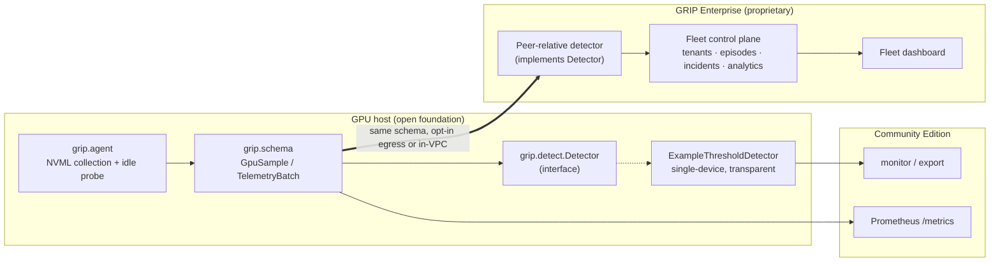

# How Community telemetry meets the commercial service

The open foundation and the commercial product share one contract — the telemetry
`schema` and the `Detector` interface. The same agent feeds both; only the
detector and the control plane differ.

**The seam.** A site runs the open agent. Locally it gets monitoring, export and
Prometheus with the transparent example detector. If they adopt Enterprise, the
*same* `TelemetryBatch` flows to the commercial engine — which implements the same
`Detector` interface but with peer-relative reliability intelligence — and on to
the fleet plane. Nothing about the agent changes; no second collector.

**What crosses the line, and what does not.** The schema, the agent, the detector
interface and the example detector are open. The peer-relative detector (method,
weights, thresholds), the control plane, tenancy and auth are commercial. The open
tier never imports a commercial module — enforced by an independence check in the
export build.

## Feature boundary

| Capability | Open foundation | Commercial |
|---|---|---|
| Telemetry collection (NVML), export, Prometheus | ✓ | ✓ |
| `Detector` interface + example single-device detector | ✓ | ✓ |
| Peer-relative gray-degradation detection | — | ✓ |
| Workload/capacity attribution, episodes, incidents | — | ✓ |
| Multi-cluster control plane, tenants, auth, dashboard | — | ✓ |
