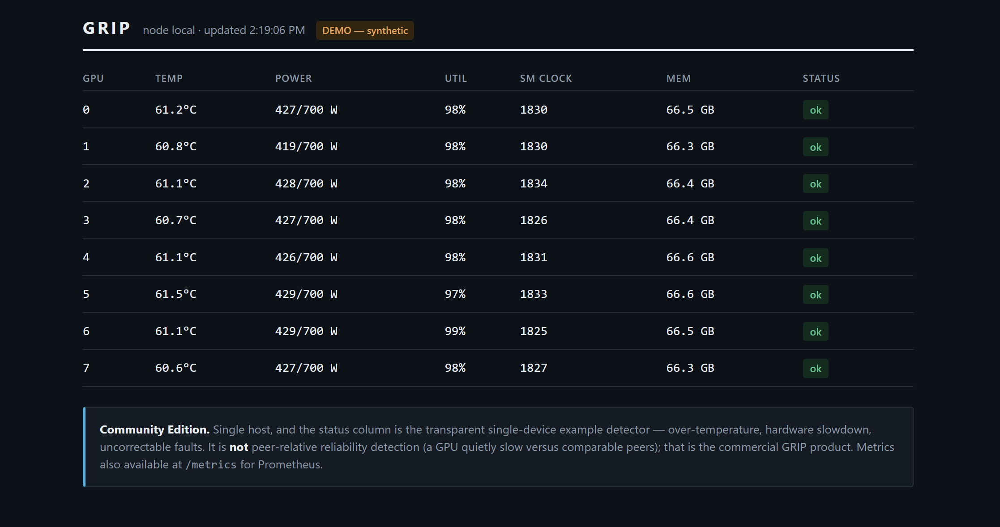

# GRIP Community Edition

Open GPU telemetry for a single host: discover your GPUs, watch temperature,
power, clocks and utilization, run transparent single-device health checks,
export the data, and scrape it with Prometheus. No account, no cloud, no data
leaves your machine.

> **What this is not.** Community Edition does **not** do peer-relative reliability
> intelligence, fleet analytics, or failure prediction. Its example detector
> compares each GPU against fixed thresholds and will miss a GPU that is quietly
> slower than its neighbours while every absolute reading still looks fine.
> Catching that is what GRIP's commercial product is for. See
> [Community vs Enterprise](#community-vs-enterprise).

## Five-minute start

```bash
pip install grip-community            # or: pip install "grip-community[gpu]" on an NVIDIA host
python -m grip.community.cli discover            # list your GPUs
python -m grip.community.cli monitor             # live table, Ctrl-C to stop
python -m grip.community.cli monitor --demo      # synthetic data — try it with no GPU
python -m grip.community.cli export today.json   # or today.csv
python -m grip.community.cli dashboard --demo    # local web UI at http://localhost:9835/
python -m grip.community.cli metrics --port 9835 # Prometheus at :9835/metrics
```

No GPU handy? Every command takes `--demo` and runs on a synthetic 8-GPU node, so
you can see the output before installing anything on real hardware. Synthetic data
is labelled as such and is never a measurement of your hardware.

## Sample output

The local dashboard (`grip-community dashboard`), here on `--demo` synthetic data:



In the terminal:

```
14:46:43  node=local
gpu   temp        power   util   clock  status
----------------------------------------------
  0    61C   427/ 700W    98%   1830  ok
  1    88C   440/ 700W    99%   1710  warn  temperature 88C >= 87C; thermal throttling active
  2    61C   428/ 700W    98%   1834  ok
```

Prometheus:

```
grip_gpu_temperature_celsius{gpu="0",uuid="GPU-…",node="local"} 61.0
grip_gpu_power_watts{gpu="0",uuid="GPU-…",node="local"} 427.0
grip_gpu_finding{gpu="1",severity="warn",signal="temperature_c"} 1
```

## Supported hardware

| Vendor | Collection | Notes |
|---|---|---|
| NVIDIA (data-center & workstation) | Yes, via NVML (`pynvml`) | Primary. Driver + NVML must be present. |
| AMD (Instinct) | **Experimental** | Packaged telemetry collection via `amdsmi` (ships with ROCm). Untested on real AMD hardware by us; amdsmi field names vary by ROCm version, so treat it as best-effort. Collection only — no detection claim. |

CPU/OS: Linux and Windows for `discover`/`monitor`/`export`/`metrics`. The
systemd service installer (in the full agent) is Linux-only.

## What the agent does to your machine

Collection is **passive**: it reads NVML and runs `nvidia-smi` only with
read-only `--query-*`. There is **no code path that changes a GPU, clock, power
limit, or driver setting**. It is not, however, strictly "read-only": the full
GRIP agent can run a small, idle-gated GEMM benchmark (~1% of GPU time, off by
default here, disable with `--no-probe`) because measuring achieved throughput
needs real work on the device. Community Edition's `monitor`/`export`/`metrics`
do passive collection only. Full privilege details:
[SECURITY.md](SECURITY.md).

## Write your own detector

`grip.detect.Detector` is a stable, versioned interface. Implement `assess(samples)
-> list[Finding]` and plug in any logic. The shipped `ExampleThresholdDetector`
is deliberately simple and transparent — read it; it hides nothing.

## Community vs Enterprise

| | Community (this) | GRIP Enterprise |
|---|---|---|
| GPU telemetry, local monitoring, export, Prometheus | ✓ | ✓ |
| Local single-host web dashboard | ✓ | ✓ |
| Transparent single-device threshold checks | ✓ | ✓ |
| **Multi-cluster fleet dashboard** | ✗ | ✓ |
| **Peer-relative gray-degradation detection** | ✗ | ✓ |
| Workload impact & capacity attribution | ✗ | ✓ |
| Episodes, incidents, history across jobs | ✗ | ✓ |
| Multi-cluster fleet control plane, tenants, auth | ✗ | ✓ |
| Hosted or in-VPC deployment, support | ✗ | ✓ |

We do not claim advanced anomaly detection, predictive reliability, or fleet
intelligence in this free edition. Those are the commercial product.

## Known limitations

- The example detector is single-device only — it catches over-temperature,
  hardware slowdown and uncorrectable faults, and misses sub-threshold
  degradation by design.
- GRIP has one controlled real-hardware experiment and a resolved false-alert
  study; it has **no production validation** and does **not** predict failures.
- AMD collection is not packaged in this edition yet.

## Roadmap

A packaged AMD adapter and more exporters. The commercial
reliability intelligence and fleet plane are separate; this edition stays a clean,
honest telemetry foundation.
